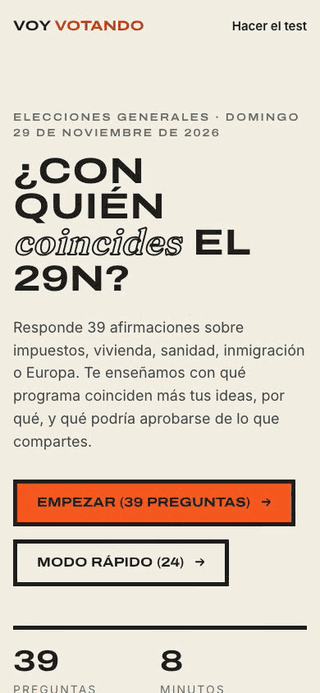
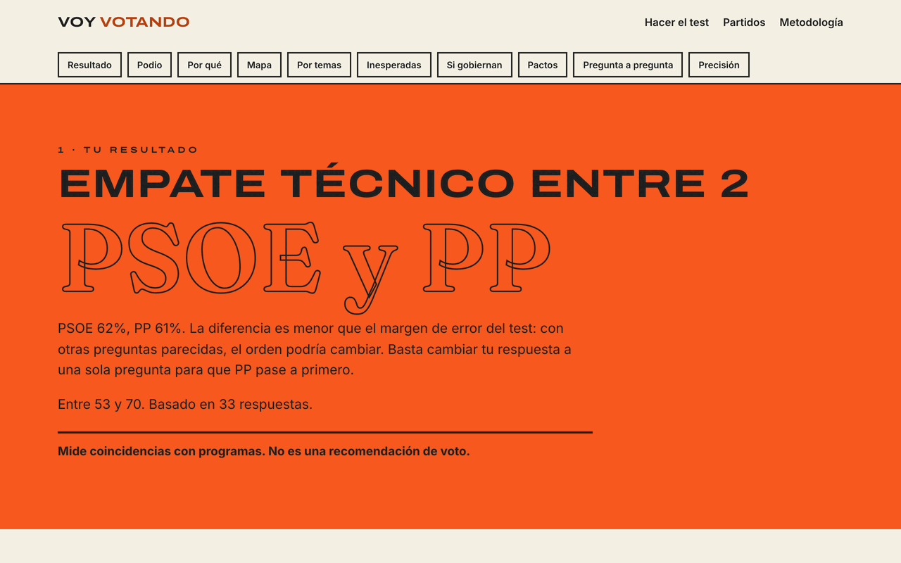
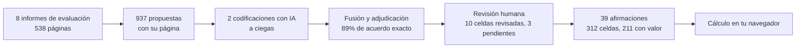

<div align="center">

<a href="https://voyvotando.bull-labs.com">
  <picture>
    <source media="(prefers-color-scheme: dark)" srcset="docs/assets/logo-dark.png">
    
  </picture>
</a>

### Compara tus ideas con los programas de 8 partidos para las generales del 29 de noviembre de 2026.

Todo se calcula en tu navegador. Sin cookies, sin anuncios y con la fórmula publicada.

[**Hacer el test**](https://voyvotando.bull-labs.com) · [Cómo calcula](docs/metodologia.md) · [Corregir una posición](https://github.com/eherrerosj/voyvotando/issues/new?template=correccion-posicion.yml) · [Contribuir](CONTRIBUTING.md)

[](https://github.com/eherrerosj/voyvotando/actions/workflows/ci.yml)
[](LICENSE)
[](LICENSE-DATA)


<br>



</div>

## ¿Por qué existe?

He desarrollado este proyecto para averiguar de forma objetiva a quién debería votar, según mis ideas. Hay otras webs que hacen lo mismo, pero las que probé tenían al menos uno de estos 4 problemas:

1. Llevan rastreadores, y tus respuestas sobre política acaban en manos de terceros.
2. Son de pago o piden registrarse para ver el resultado.
3. Están llenas de publicidad.
4. No explican cómo calculan la afinidad, así que no se puede comprobar el resultado.

Voy Votando resuelve los 4. Tus respuestas no salen del navegador. La fórmula, los datos y el código son públicos. Cada posición de partido lleva la cita de la que sale.

## En qué se diferencia

| | Problemas frecuentes en otros tests | Voy Votando |
|---|---|---|
| Rastreadores | Scripts de analítica y publicidad | Ninguno. La cabecera CSP bloquea cualquier conexión a otro dominio. |
| Tus respuestas | Se envían a un servidor | Se quedan en tu navegador |
| Publicidad | Anuncios o contenido patrocinado | Ninguna |
| Precio | Pago o registro para ver el resultado | Gratis y sin registro |
| Fórmula | Sin publicar | Publicada, con su código y sus pruebas |
| Posición de cada partido | Sin fuente | Cita literal de 25 palabras como máximo, con su página |
| Margen de error | No se muestra | Intervalo del 90% y aviso de empate técnico |
| Código | Cerrado | Abierto, con licencia AGPL-3.0 |

## Qué ofrece

- 39 afirmaciones en 8 bloques, unos 8 minutos. El modo rápido tiene 24, unos 5 minutos.
- Puedes elegir hasta 3 temas prioritarios. Pesan ×2,0, ×1,5 y ×1,2.
- Cada pregunta tiene una ayuda: situación actual, argumentos a favor y en contra, y enlaces a la página exacta de cada informe.
- La página de resultados tiene 10 secciones: titular, podio, por qué, mapa, por temas, coincidencias inesperadas, si gobiernan, pactos, pregunta a pregunta y precisión.
- El titular avisa de un empate técnico cuando la diferencia es menor que el margen de error.
- Si una sola respuesta cambiaría tu primer puesto, la web te dice cuál.
- "Si gobiernan" muestra la probabilidad de aprobar cada medida según los escenarios de gobierno de cada informe.
- Puedes compararte con otra persona a partir de su enlace de resultado, sin servidor.
- El resultado se puede imprimir, guardar en PDF o compartir como imagen.
- Funciona con teclado: Intro avanza, 1 a 5 responden, 0 salta y las flechas navegan.
- Pasa las comprobaciones WCAG 2.2 AA de axe. Tiene modo oscuro y se prueba en 6 tamaños de móvil y tableta en cada cambio.
- Hay una ficha por partido con su programa, su equipo, sus pactos y su cercanía con los otros 7.

<div align="center">

</div>

## Cómo funciona



1. Cada partido tiene un informe de evaluación de su programa oficial. Los 8 informes usan el mismo marco: medidas, coste, escenarios de gobierno y probabilidad de aprobación.
2. Dos agentes de IA codificaron por separado la posición de cada partido ante cada afirmación, en una escala de −2 a +2. Cuando los dos dan valor, coinciden exactamente en el 89% de los casos y a 1 punto o menos en el 99%.
3. Un script comprueba que cada cita aparece en su página del informe. Si una falla, la exportación se detiene.
4. Tu respuesta $u$ y la posición del partido $p$, ambas de −2 a +2, se comparan con un modelo híbrido de proximidad y dirección:

$$
a(u,p) = 0{,}5\left(1-\frac{|u-p|}{4}\right) + 0{,}5\left(0{,}5+\frac{u\,p}{8}\right)
$$

5. La afinidad con cada partido $k$ pondera cada pregunta por tu prioridad $w_q$ y por la confianza de la posición $c_{kq}$ (1, 0,75 o 0,5). Las preguntas sin posición documentada no cuentan:

$$
S_k = 100 \cdot \frac{\sum_q w_q\, c_{kq}\, a(u_q, p_{kq}) + 2}{\sum_q w_q\, c_{kq} + 4}
$$

6. Un bootstrap de 1.000 remuestreos de tus respuestas da el intervalo del 90% y detecta los empates técnicos. La semilla sale de tus respuestas, así que el mismo test da siempre el mismo resultado.

La fórmula completa, con ejemplos resueltos y casos límite, está en [docs/metodologia.md](docs/metodologia.md). El motor está en [`src/lib/scoring.ts`](src/lib/scoring.ts).

### Validación

`npm run validar` simula votantes con el mismo motor que usa la web. Cada votante sintético parte de las posiciones de un partido y añade ruido.

| Prueba | Modo completo (39) | Modo rápido (24) |
|---|---|---|
| Autotest: cada partido responde sus propias posiciones | 8 de 8 en primer puesto; margen mínimo 2,2 puntos | 8 de 8 en primer puesto; margen mínimo 1,9 puntos |
| Recuperación con ruido σ = 0,75 | 0,980 a 1,000 | 0,937 a 0,999 |
| Recuperación con ruido σ = 1,25 | 0,876 a 0,989 | 0,784 a 0,985 |
| Primer puesto con respuestas al azar (ideal: 12,5% cada uno) | 5,8% a 20,6% | 5,6% a 18,7% |
| Empate técnico con el primero, σ = 0,75 | 3,3% | 8,3% |
| Empate técnico con el primero, σ = 1,25 | 15,7% | 25,8% |
| Todo «Neutral»: primer puesto | PSOE, 0,9 puntos por delante | PSOE, 1,5 puntos por delante |

La recuperación es la proporción de votantes sintéticos que reciben su partido en primer puesto.

## Privacidad que puedes comprobar

- No hay cookies, analítica, anuncios ni scripts de terceros.
- Las respuestas viven en la memoria de la pestaña. Una copia en `sessionStorage` permite retomar el test si recargas, y se borra al terminar.
- El enlace de resultado guarda tus respuestas después del `#`. El navegador nunca envía esa parte de la dirección al servidor.
- La cabecera `Content-Security-Policy` incluye `connect-src 'self'`. El navegador bloquea cualquier intento de enviar datos a otro dominio.
- Solo se ejecutan los scripts de la propia web. La CSP fija el hash SHA-256 de cada script en línea.
- La web no publica datos agregados de uso.

Para comprobarlo, abre las herramientas de desarrollo del navegador, ve a la pestaña Red y haz el test. Solo verás peticiones a `voyvotando.bull-labs.com`, y ninguna lleva tus respuestas.

## Neutralidad

- Los 8 partidos pasan por el mismo proceso, la misma escala y las mismas reglas.
- Si un informe no documenta una postura, la celda queda vacía y no cuenta. Ninguna posición se deduce por ideología.
- Las afirmaciones tienen una sola idea y no nombran partidos ni personas. Un script lo comprueba.
- El banco está equilibrado: 17 afirmaciones coinciden más con Podemos, Frente Amplio y PSOE, 15 con PP, Vox y SALF, y 7 son transversales.
- La proximidad pura daba ventaja a los partidos con posiciones intermedias. En la versión 1.0, con 6 partidos y respuestas al azar, el PSOE quedaba primero el 42% de las veces. El modelo híbrido lo bajó al 28,4%.
- Los argumentos a favor y en contra se escriben como efectos, con la misma forma.
- No hay colores ni logotipos de partido. El orden por defecto es alfabético.
- La web mide coincidencias con programas. No recomienda ningún voto.

Las reglas completas están en [AGENTS.md](AGENTS.md). Valen igual para personas y para agentes de IA.

## Datos

| Carpeta | Contenido |
|---|---|
| [`data/reports`](data/reports) | Los 8 informes de evaluación en PDF |
| [`data/partidos.json`](data/partidos.json) | La lista de partidos: nombres, informe, socios, ámbito, provincias y unidades |
| [`data/extracted`](data/extracted) | Texto extraído, las 2 codificaciones, la adjudicación, el banco de preguntas, los prompts y los scripts |
| [`src/content`](src/content) | Los JSON que usa la web, generados con `npm run data` |
| [`docs/historial-de-datos.md`](docs/historial-de-datos.md) | Cambios de cada versión de los datos, con la revisión humana |

El autor del proyecto elaboró los 8 informes con ayuda de IA, a partir del programa oficial de cada partido y de fuentes públicas como el BOE, la AIReF o el Banco de España. [`data/README.md`](data/README.md) explica cada fichero de la cadena: entrada, script y salida.

## Limitaciones

- Solo cubre los 8 partidos con informe: EH Bildu, Frente Amplio, PNV, Podemos, PP, PSOE, SALF y Vox. Junts, ERC, BNG, Coalición Canaria y UPN no tienen informe.
- EH Bildu solo se presenta en Álava, Bizkaia, Gipuzkoa y Navarra, y PNV en Álava, Bizkaia y Gipuzkoa. La web los compara igual que al resto y avisa de dónde se presentan.
- Las posiciones salen de los informes. Un programa puede no tratar un tema, y entonces el partido no puntúa en esa pregunta.
- Con respuestas al azar, PNV, PSOE y PP quedan primeros más a menudo (20,6%, 18,8% y 17,7%). PNV tiene posición en solo 14 preguntas, y la fórmula acerca a 50 las afinidades con pocas posiciones. El 72% de las posiciones del PSOE y el 59% de las del PP son intermedias, y una respuesta al azar queda más cerca de ellas.
- Si respondes «Neutral» en el 60% de las preguntas o más, el resultado lo avisa.
- 39 afirmaciones no recogen todo un programa. El test no mide liderazgo, gestión ni confianza en las personas.

## Desarrollo local

Requisitos: Node.js 22.23 o posterior. Python 3 solo para regenerar los datos.

```sh
npm ci
npm run dev        # http://localhost:4321
npm test           # 34 pruebas del motor y del enlace de resultado
```

Otros comandos:

| Comando | Qué hace |
|---|---|
| `npm run check` | Comprueba los tipos |
| `npm run build` | Genera la web estática en `dist/` con la cabecera CSP |
| `npm run data` | Regenera `src/content` desde `data/` y verifica cada cita |
| `npm run validar` | Simula votantes y da la tabla de validación |
| `npm run qa:responsive` | Revisa 6 tamaños de móvil y tableta con axe (requiere `npm run preview`) |

## Despliega tu copia

`npm run build` genera una web estática en `dist/`. Funciona en cualquier alojamiento de ficheros estáticos.

- Cloudflare Workers: cambia la ruta de `wrangler.jsonc` por tu dominio y ejecuta `npx wrangler deploy`. La cabecera `Cache-Control: no-transform` evita que Cloudflare Web Analytics inserte su script, aunque esté activo en tu zona.
- Otros alojamientos: sube `dist/` y configura las cabeceras de `dist/_headers`, sobre todo la CSP.

## Adáptalo a otras elecciones

La cadena de datos sirve para otras elecciones con otros informes que sigan un marco común. [docs/adaptar-a-otras-elecciones.md](docs/adaptar-a-otras-elecciones.md) explica los pasos: extraer los informes, codificar 2 veces, adjudicar, construir el banco y exportar.

Para añadir un partido cuando llega su informe, sigue [docs/incorporar-partidos.md](docs/incorporar-partidos.md). La versión 1.1 añadió así a EH Bildu y PNV, con el mismo banco de preguntas.

## Contribuir

La contribución más útil es corregir una posición mal codificada. Abre un issue con la plantilla [Corrección de una posición](https://github.com/eherrerosj/voyvotando/issues/new?template=correccion-posicion.yml) e incluye la cita que la respalda.

Para código, datos o errores, lee [CONTRIBUTING.md](CONTRIBUTING.md). Los fallos de seguridad o privacidad se avisan en privado, según [SECURITY.md](SECURITY.md). El proyecto sigue un [código de conducta](CODE_OF_CONDUCT.md).

## Licencia

- Código: [GNU AGPL-3.0](LICENSE). Si publicas una versión modificada en un servidor, tienes que publicar su código.
- Datos e informes (`data/` y `src/content/`): [CC BY 4.0](LICENSE-DATA). Puedes reutilizarlos citando la fuente.
- Fuentes tipográficas Archivo, Fraunces e Inter: SIL Open Font License 1.1.

## Créditos

- Diseño visual inspirado en [politicalplaylist.com](https://politicalplaylist.com/).
- Hecho con [Astro](https://astro.build), [React](https://react.dev), [Vitest](https://vitest.dev), [fast-check](https://fast-check.dev) y [Playwright](https://playwright.dev).
- El modelo híbrido de proximidad y dirección sigue a Mendez (2012), que compara estos modelos en aplicaciones de consejo de voto.
